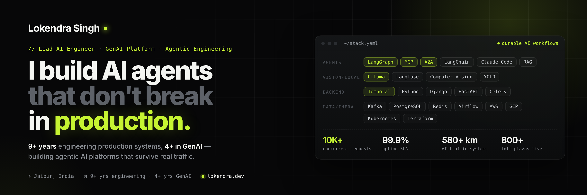

Lead AI Engineer, Jaipur. 9+ years building software, 4+ of them on
agentic AI and GenAI platforms that survive real production traffic.

I'm solution-oriented: the language and the framework are only the medium, and
what counts is that the problem gets solved.

**What I build**
- GenAI automation platforms for enterprise clients on a 99.9% uptime SLA
- Durable agent workflows on Temporal, speaking MCP and A2A
- Event-driven traffic and data systems, including AI traffic management on the Delhi–Mumbai Expressway

**Open source**
- [urlpaste](https://github.com/lokendra-builds/urlpaste) - share a note as a link,
  with nothing saved anywhere. Python · Streamlit · AES-256-GCM · MIT

**Find me** · 
[lokendra.dev](https://lokendra.dev) ·
[Case studies](https://lokendra.dev/#projects) ·
[Writing](https://lokendra.dev/writings/) ·
[LinkedIn](https://www.linkedin.com/in/lokendra-singh-rathore-/)
